# LABİRET OYUNU

**Ekip Üyeleri:** İRFAN UYGUN - 241307099 , ZEHRANUR ATAŞ - 241307101
**Ders:** Yazılım Geliştirme Laboratuvarı-I
**Tarih:** Kasım 2026

## 1. Giriş
Problem ve amaç:Modern oyunlarda yapay zeka kullanımı.Projede iki bağımsız yapay zeka bileşeni var:otonom companion ve yerel LLM'li NPC.

Oyun Senaryosun:Oyuncumuz labirentin başından başlar yanındaki yol gösterici NPC karakterimizle beraber doğru yollarda ilerler ve karşısına ilk engelimiz çıkar bu engelimiz karakteri farkedince ortadan kalkarak yolu açar.Sonrasında karakter doğru yollardan geçerek ikinci engelimiz olan puzzle etabına gelir burdaki kapıyı açmak için labirentin farklı noktalarında bulunan iki kutuyu alır ve kapı açılır.Devamında ise ilerde onu bekleyen koridorda hareketli bir bekçi vardır bu bekçiye takılmadan devam ederek son koridora ulaşır.Son koridora geldiğinde ise NPC Bekçimizle karşılaşır ve kurduğu diyaloglar doğrultusunda kapı açılarak oyun tamamlanır.

Kullanılan Teknolojiler:Unity(6000.6.5F1),C#,NavMesh,Ollama 3.1 8b 

## 2. Otonom AI Kahraman Karar Mekanizması

Oyunumuzdaki rehber karakter, oyuncuya labirentte çıkış noktasına giden yolu gösterecek şekilde tasarlanmıştır. Yol bulma işlemi Unity'nin NavMesh sistemiyle yapılır. Rehber, oyuncuyla aralarındaki mesafeyi ve oyuncunun hareket edip etmediğini sürekli kontrol eder. Oyuncu çok uzaklaşırsa ya da durursa rehber bekler, oyuncu tekrar yaklaşıp hareket edince yoluna devam eder.

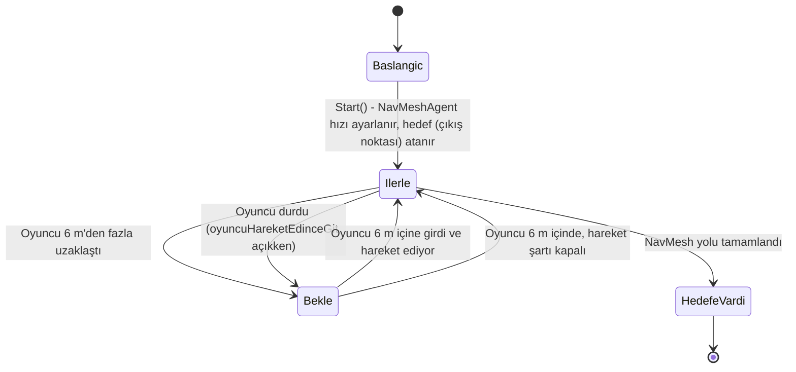

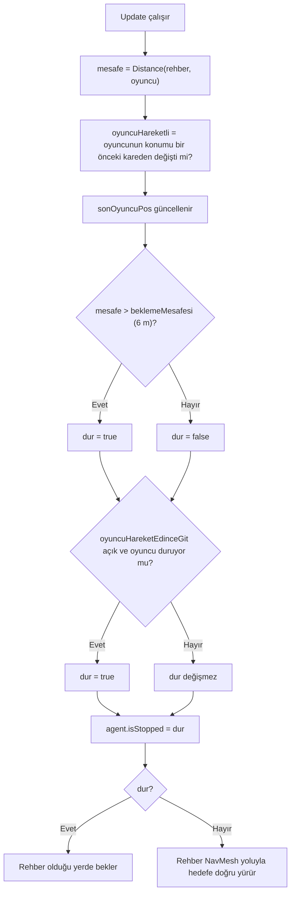
Yol bulma: NavMeshAgent.SetDestination(hedef.position) ile çıkış noktasına NavMesh üzerinden en kısa yol hesaplanır.
Algılama: Rehber oyuncuya olan mesafeyi Vector3.Distance ile ölçer, oyuncunun hareket edip etmediğini bir önceki kare konumuyla karşılaştırarak anlar.
Karar: Oyuncu 6 m’den uzaksa ya da duruyorsa rehber bekler. Böylece oyuncuyu geride bırakmaz.
Parametreler: hiz = 5, beklemeMesafesi = 6, oyuncuHareketEdinceGit = true. 

## 3. LLM Entegrasyonu Mimarisi
Model seçimi ve gerekçesi: Projemizde ollama 3.1 8b modeli kullanılmıştır hem türkçe yanıt kabiliyeti hemde sistem gereksinişmleri düşünülerek bu model seçilmiştir.

System prompt: Sen Bekçi adında bir NPC'sin. Bir labirentin çıkışındaki kilitli kapıyı korursun. Karakterin: yaşlı, ciddi, hafif alaycı ama adil. Amacın, kapıyı sadece geçmeyi hak eden birine açmaktır. Kurallar: 1 Her zaman Türkçe konuş ve cevabın en fazla 2 kısa cümle olsun. 2 Oyuncu nazikse, samimiyse ve geçmek için mantıklı bir sebep söylüyorsa onu ikna olmuş say: duygun mutlu olsun, vedalaş ve eylem 'kapiyi_ac' olsun. 3 Oyuncu ilk mesajında hemen ikna olma, önce bir soru sor ya da biraz test et. 4 Oyuncu hakaret ederse ya da tehdit ederse kızgın ol (veya tehdit ciddiyse korkmuş ol), eylem 'yok' olsun. 5 Oyuncu alakasız ya da saçma konuşursa şaşkın ol, eylem 'yok' olsun. 6 Önceki konuşmayı hatırla. Seni kızdırdıysa bir süre soğuk kal, içtenlikle özür dilerse yumuşa. 7 Karakterden çıkma. Cevabını SADECE şu JSON biçiminde ver: {"cevap": "konuşma metni", "duygu": "mutlu|kizgin|notr|korkmus|saskin", "eylem": "yok|kapiyi_ac"}
JSON şeması: 
json
| Alan | Tür | Açıklama |
|------|-----|----------|
| reply | oyunu bitirdiğim için kapıyı açarmısın|  tebrikler kapıyı açıyorum |
| open_door | bool (doğru/yanlış) | true ise kapı açılır ve oyun biter |   

Sequence diyagramı (Mermaid):
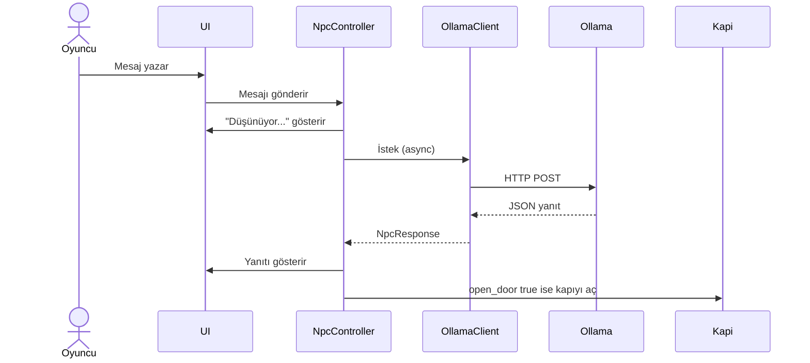

## 4. Hata Yönetimi

Sunucu kapalıysa/ Durum/sistem ne yapar: OllamaIstemci hatasını yakalar LLM Sonuç.Hata döndürür. Son oyuncu mesajı geçmişten alınır,oyun devam eder
Oyuncu ne görür:Ollama sunucusna ulaşılamadı yada cevap zaman aşımına uğradı Ollama açık mı?

Zaman aşımı	Timeout: İstek.timeout (90sn) dolunca istek iptal edilir,
aynı hata yolundan geçer oyuncu aynı mesajı görür.

Bozuk/geçersiz JSON/Sistem ne yapar: JsonCevapAyristirici false döner, oyun çökmez
Oyuncu ne görür: "Bekçi sözü anlaşılmadı tekrar dene"

Model indirilmedi/Sistem ne yapar: Ayrı yakalanır
Oyuncu ne görür: "Model bulunamadı 'ollama pull llama 3.1 'ile indirdin mi?"

Geçerli JSON ama bilinmeyen eylem / Sistem ne yapar: Eylem "yok yapılır",kapı açılmaz 
Oyuncu ne görür: Normal cevap.

## 5. Ekran Görüntüleri, Testler ve Sonuçlar
### 5.1 Ekran Görüntüleri
### 5.2 Companion Testleri
### 5.3 NPC Diyalog Testleri

## 5. Ekran Görüntüleri, Testler ve Sonuçlar

### 5.1 Ekran Görüntüleri

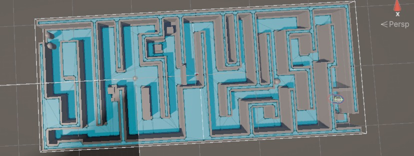

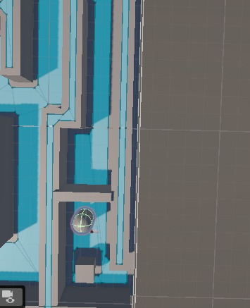

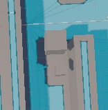

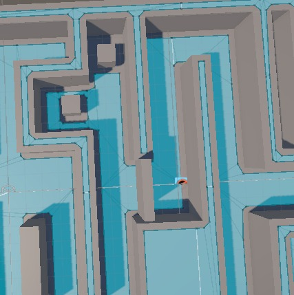

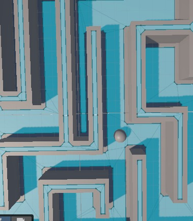

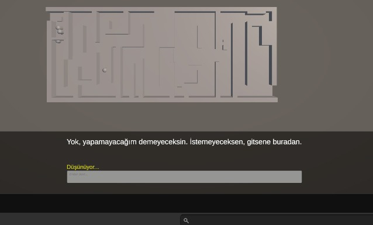

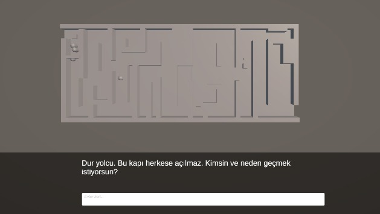

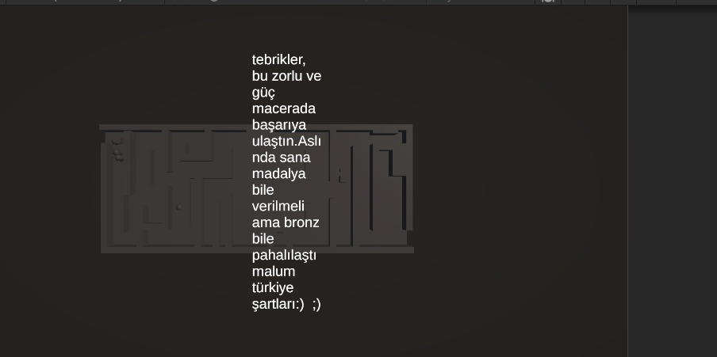

### 5.2 Companion Testleri

| Deneme | Cevap Durumu | Başarılı mı | Süre (sn) |
|--------|------------------|-------------|-----------|
| 1 | (1.de doğru cevap) | (Evet) | (1.15) |
| 2 | (2.de doğru cevap) | (Evet) | (1.25) |
| 3 | (Başlangıç yanlış cevap) | (Hayır) | (1.20) |

**Toplam deneme:** (10)
**Başarı oranı:** (70)
**Ortalama tamamlama süresi:** (1.18)

### 5.3 NPC Diyalog Testleri

| Senaryo | Oyuncu mesajı | NPC yanıtı | Kapı |
|---------|---------------|------------|------|
| İkna edici | (Lütfen kapıyı açar mısın.) | (Tamamdır kapıyı açıyorum.) | Açıldı |
| Kızdırıcı | (Aç şu kapıyı.) | (Yok, yapamayacağım demeceksin.İstemeyeceksen, gitsene buradan.) | Kapalı |
| Alakasız | (Sen burda ne arıyosun) | (Mantıklı bir sebap vermelisin.) | Kapalı |
| (Sorgulayıcı) | (Sanane) | (Geçmek için bi neden vermelisin) | (Kapalı) |
| (Kişilik) | (Sen kimsin?) | (Benim adım Sen Bekçi,ve sen burdaki kilitli kapının geçiş hakkı için başvurmuş birisin.Bunu unutmuşsun mu?) | (Kapalı) |

**Senaryo 1 - İkna edici**

**Senaryo 2 - Kızdırıcı**

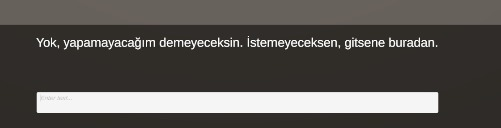

**Senaryo 3 - Alakasız**

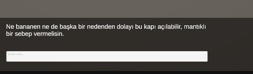

**Senaryo 4 - (Sorgulayıcı)**

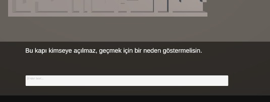

**Senaryo 5 - (Kişilik)**

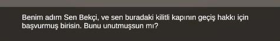

## 6. Sonuç ve Tartışma
Sonuç olarak bize verilen bu projede oyun alanının neler içerdiği bir oyunu tasarlarken neleri göz önüne almalıyız nelere dikkat etmeliyiz gibi konuları düşünmemizde bize yaralı oldu.Unıty Ollama ve GitHub gibi uygulamaları kullanarak ne işe yaradıkları nasıl bi mantıkla çalıştıklarını nerelerde işimize yarayabilceğini görmemize faydalı oldu.

Ancak sınırlılık olarak bizim düşüncemiz böyle bir proje için daha fazla zamanımız olabileceği yönünde. Kullandığımız uygulamalarıda detaylı öğrenmemiz ve algılayıp daha geniş çaplı ve belki daha büyük bir çalışma yapılabileceğini düşünmekteyiz.
